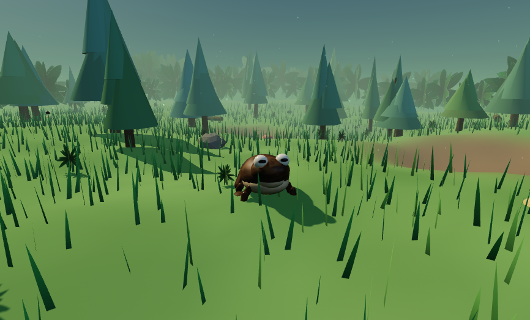
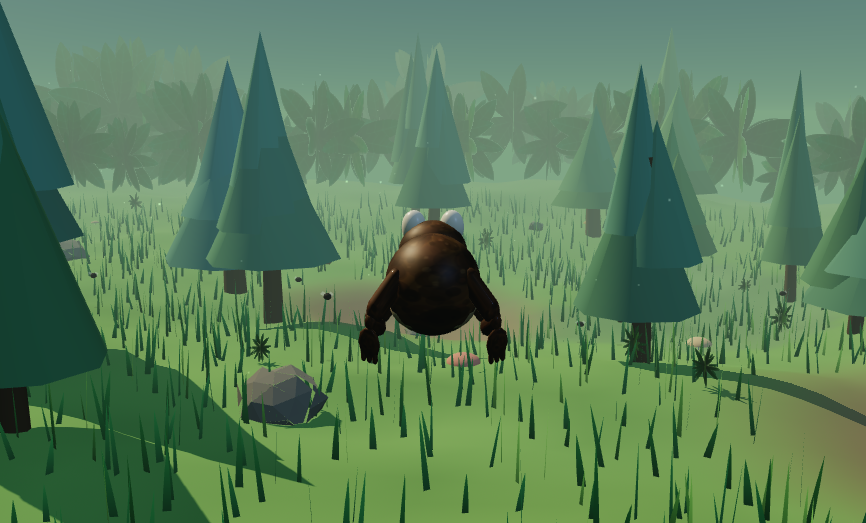

# Toad Feast

You're a toad in a jungle clearing. Flies buzz around you, your hunger never stops
draining, and the only way to stay alive is to eat them — by whipping your long sticky
tongue out at them.

That's the whole game: wander, chase, eat, and last a little longer than you did last
time. A good run is a minute or two. It's a small, silly, oddly satisfying loop, and the
"best" number in the corner is the only reason you'll keep coming back.

## Playing it

Download `toad-game.html` and double-click it. It opens in Chrome, Edge or Firefox,
and the game starts the moment you click the screen. Nothing to install, nothing to
build, no account, no ads, no launcher.

The only thing it needs is an internet connection, because the 3D library it runs on is
fetched from the web when the page loads.

Or turn on GitHub Pages for the repository and it will play right in the browser without
downloading anything at all.

There's also a touch fallback if you open it on a phone, and it works with a normal
Xbox or PlayStation controller if one happens to be plugged in.

## Controls

- **W A S D** or the arrow keys — walk around the clearing
- **Space** — a little hop
- **Shift** — a real leap: a big forward lunge that will carry you over a pond
- **Left click** — tongue flick toward wherever you're looking
- **E** or **J** — tongue flick straight ahead
- **Mouse drag** — swing the camera around the toad
- **Scroll wheel** — zoom in and out
- **C** — croak. It does nothing useful. Do it anyway.
- **P** or **Esc** — pause (the pause screen lists all of this again)
- **M** — mute, and there's a volume slider in the pause menu
- **R** — give up and start a fresh run
- **H** — bring the controls back up if you've forgotten them

If your cursor gets captured and you want it back, press Esc.

## What you'll notice

Rolling ground with mud at the edge of three shallow ponds you can wade or leap across.
Tall grass that leans in the wind, ferns, mushrooms, fallen logs, rocks, and a wall of
dense jungle that politely refuses to let you leave. Flies whine louder as you get
closer. Your tongue leaves your mouth, not your chest, and it will quietly snap onto a
fly that's roughly in the direction you were aiming — it's a forgiving game on purpose.
Eat two flies in quick succession and you'll get a combo bonus. Get down to your last
dregs of hunger and your heart starts thumping in the speakers.

Your best run is remembered by your browser, so the "best" number is still there when
you come back.

## A few tips

- Standing still burns hunger much more slowly than walking. Resting is a real strategy.
- Leaping covers two or three times the ground of a hop but costs more, so save it for
  gaps and for the flies hovering out of a hop's reach.
- You can flick your tongue in mid-air. Some of the best flies are the ones you catch
  on the way up over a pond.
- The tongue shoots straight out of your mouth, level, and quietly snaps onto any fly
  roughly in the direction you're facing. Line it up with the middle of the screen.

## How this was made

Toad Feast was made with **Strata**, working alongside **Qwen3.8-Flash-Next IQ3_S**,
on an ordinary desktop PC.

It's genuinely one file. Everything in it — the toad, the trees, the flies, the grass,
the leaf textures, the whole soundtrack of wind, crickets, buzzes, croaks and splashes —
is described in code and drawn or sung fresh each time you open it. There are no image
files, no sound files, no models, and nothing to compile. You can open the file in
Notepad if you're curious.

The only outside piece is [three.js](https://threejs.org), the friendly 3D library it
stands on, which is pulled in at runtime and is MIT licensed like this game.

Most of the work was back and forth rather than big design up front: the toad started
green until somebody pointed out that toads are brown; the tongue used to fire at the
angle the camera was pointed, which put it through the dirt; the leap replaced a much
less fun "walk faster" button. Small honest fixes like that, one after another, until it
felt good.

## If you want to tinker

Open the file in any text editor and near the top there is one tidy block of settings
with a comment above it. That's where the whole game's personality lives: how fast hunger
drains, how many flies are out at once, how far the tongue reaches, how big a leap is.
Change a number, save, refresh, and the game is different. It's all safe to poke at.

## Credits

Written and put together by **duffyjp** — [github.com/duffyjp](https://github.com/duffyjp).
The game lives at [github.com/duffyjp/toad-game](https://github.com/duffyjp/toad-game).

3D rendering by the three.js authors (MIT). No other libraries, art or audio were used,
because none were needed.

## License

MIT — see [LICENSE](LICENSE). Take it, change it, put your own toad in it. Just keep the
copyright line, and honestly, if you make a better toad I'd like to see it.

This is a hobby project made for fun. It comes with no warranty of any kind, and no
toads were harmed, because there are no toads.
